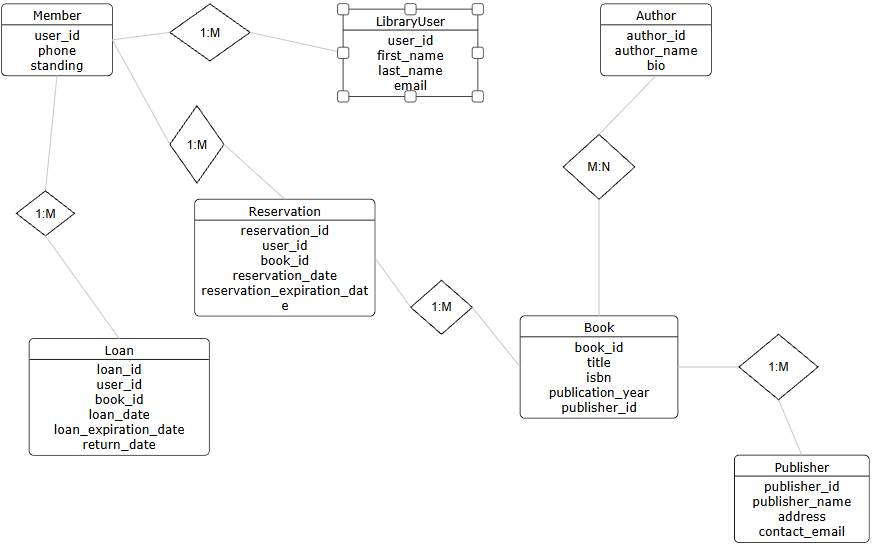
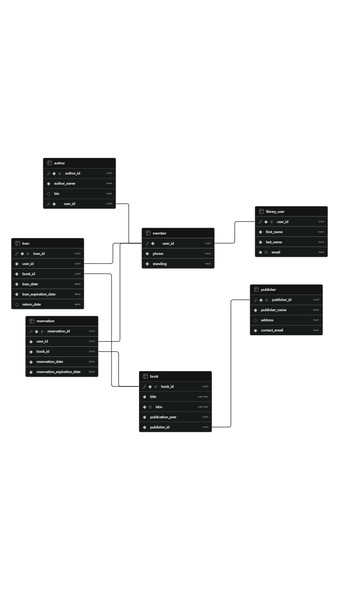

# **HOW WE DID IT**
## SCOPE
- The library database project is focused on developing a relational database that supports the operations of a library management system by organizing and managing information related to library users, members, authors, publishers, books, loans, and reservations.
---
### GOAL
The primary goal was to create a functional database structure that maintains accurate records, enforces relationships between entities, and allows information to be efficiently retrieved and managed through SQL queries.
- We wanted it to be simple, so we researched potential methods of implementation.
  - The three probable routes to host and manage the database would be to use:
    - [PostgreSQL](https://www.postgresql.org/)
    - [Supabase](https://supabase.com/) (Cloud Hosted Postgres Service)
    - [ProgramizSQL](https://www.programiz.com/sql/online-compiler/) (Live SQL Editor)
### DECISION
We decided to use [Supabase](https://supabase.com/) because of it's simplicity and ease of access across the board. It is a completely cloud integration of Postgres, meaning any of our members can access it from mobile or desktop via the web.

---
## PHASED IMPLEMENTATION
### P1: Project Basics
Title: C202-PostgreSQL Champions
Description: A secure PostgreSQL database application developed for CYBR202. This project demonstrates database design using PostgreSQL and Supabase.
List of Key Variables:
- **ENTITIES**: Library, User, Member, Publisher, Author, Book, Loan, Reservation
- **RELATIONSHIPS**: Publisher->Book, Member->Loan, Member->Reservation, Book->Reservation, Book<->Author
### P2: ER/EER diagram / Schema

### P3: Logical Design

### P4: Supabase Implementation (CURRENTLY IP)
- SQL scripts (DDL, DML, constraints).
- Sample dataset (≥200 records).
- At least one stored procedure and one trigger.

---
### OVERVIEW
The development process utilizes several tools, including:
- Supabase as the primary PostgreSQL database platform for creating tables and managing data.
- GitHub for version control and collaboration.
- SQL for database queries.
- SmartDraw for designing the Entity-Relationship Diagram (ERD).

  The current database schema consists of seven primary tables: library_user, member, author, publisher, book, loan, and reservation. The library_user table stores general user information, including user_id, first_name, last_name, and a unique email address. The member table extends user information by storing phone numbers and membership standings via _user_id_ through a one-to-one relationship with library_user. The author table is similar, it stores author information, including author_id, author_name, bio, and _user_id_.
  The relationships between these tables form the foundation of the database structure, including a one-to-one relationship between library_user and member, one-to-many relationships between members and loans, members and reservations, books and loans, books and reservations, and publishers and books. These relationships maintain referential integrity and reduce data duplication while allowing information to be retrieved across multiple tables using SQL JOIN operations.
  The team has established population goals of approximately 72 members, 24 authors, 8 publishers, and 108 books to create a realistic testing environment.
- One of the project's key development goals is implementing a membership-standing system that evaluates members based on factors such as loan history, reservation activity, and the timeliness of book returns. Potential standing classifications include Excellent, Good, and Poor (EXACT SCORING METHODOLOGY IS STILL BEING FINALIZED). Future functionality is expected to automatically update member standings as transaction records change (the UPDATE function).
  The project also plans to implement SQL queries that can retrieve registered users and membership information, display books with associated publishers, retrieve author information, identify books currently on loan, track borrowing histories, detect overdue loans, and retrieve reservation data.
  Current development priorities include completing user and member records, finalizing author, publisher, and book data, assigning IDs and unique values, verifying all primary and foreign key constraints, completing the ERD in SmartDraw, maintaining project files through GitHub, implementing and testing SQL queries, establishing standing-calculation rules, and validating loan and reservation functionality. An additional enhancement under consideration is the creation of a book_author junction table to support books with multiple authors. Overall, the project has established a well-structured relational database foundation and is progressing from conceptual design toward a fully implemented library management solution capable of storing, managing, and retrieving library data while maintaining data integrity, supporting operational functionality, and demonstrating effective relational database principles.

---
